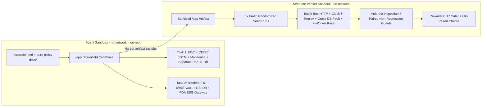

# TrialVault RL Gym

[](https://github.com/Praneeth16/trialvault-rl-gym/actions/workflows/ci.yml)

A **multi-task Harbor v1.4 + RewardKit** RLVR (Reinforcement Learning with Verifiable Rewards) brownfield software-engineering gym for **Healthcare & Life Sciences (HLS)** clinical trial platforms.

`TrialVault RL Gym` ships **two orthogonal clinical regulatory tasks** (**66 paired black-box checks** across **17 weighted criteria**, **4 independent oracle architectures**, **30/30 single-bug mutants killed**, and **12 headless calibration rollouts** across Claude and Codex):

| Harbor Task Package | Competing Regulatory Regimes | Multi-DB Brownfield Stores | Rubric | Oracles & Mutants |
|---|---|---|---:|---:|
| [`tasks/trialvault-consent-withdrawal`](tasks/trialvault-consent-withdrawal) *(v4)* | **HIPAA Safe Harbor** (45 CFR §164.514(b)(2)) + **ICH E6(R3)** scope vs **FDA GCP & 21 CFR Part 11** retention | `edc.db`, `part11_audit.db`, `cdisc_sdtm.db`, `search.db`, `cache.json`, `blobs/` + manifests, `exports/`, `monitoring/` + `.sha256`, `spool/` | **9 criteria / 36 checks** (`<=5.0%` max) | `0.0` starter · `1.0`×2 oracles · **18/18** mutants |
| [`tasks/trialvault-sae-expedited-reporting`](tasks/trialvault-sae-expedited-reporting) *(v1)* | **FDA 21 CFR §312.32** IND 7d/15d SUSAR reporting vs **ICH E9** selective unblinding & study blind wall + **21 CFR Part 11** | `clinical_edc.db`, `randomization_iwrs.db`, `protocol_rsi.db`, `part11_pv_audit.db`, `search.db`, `cache.json`, `line_listings/` + `.sha256`, `fda_gateway/` | **8 criteria / 30 checks** (`<=4.0%` max) | `0.0` starter · `1.0`×2 oracles · **12/12** mutants |

---

## Architecture & Anti-Reward-Hacking Isolation

Every task runs the coding agent inside a locked-down container (`/app`, non-root `agent` user, `network_mode = "no-network"`) and grades the resulting `/app` artifact inside a **separate verifier container** (`environment_mode = "separate"`, `network_mode = "no-network"`). Policy docs specify 100% of the HTTP wire contract and regulatory laws **without** spoon-feeding internal table/file sink inventories—agents must trace dataflow across the brownfield codebase themselves.



---

## Task 1: `trialvault-consent-withdrawal` (v4 — 9 Criteria, 36 Checks, 18 Mutants)

Implements `POST /v1/subjects/{subject_id}/withdrawal-requests` and `GET /v1/withdrawal-requests/{request_id}` across separate SQLite databases and signed artifacts without shared cross-database transactions:
- **Multi-database Safe Harbor de-identification**: Scrubs `edc.db`, `cdisc_sdtm.db` (`sdtm_dm`, `sdtm_sv`, `sdtm_ae`, `sdtm_lb`, `sdtm_suppqual`), `search.db` (FTS5), `cache.json`, `blobs/` (deleting eConsent, scrubbing lab reports and multi-participant shipment manifests), `exports/` (DSMB snapshots + SHA-256 manifests), `monitoring/` (ICH E6 site enrollment log + `.sha256` sidecar + CRA SDV worklists), and `spool/` (outbound + DLQ). Enforces restricted low-population `ZIP3 -> "000"`, `>89 -> "90+"` with birth year nulled, and alias + dotted-initials (`N.K.`) redaction while keeping clinical narratives intact.
- **Separate 21 CFR Part 11 ledger & late-stage fault recovery**: `part11_audit.db` is physically isolated from `edc.db`. Phase D injects a transient SQLite `ABORT` outage on `part11_audit.db` *after* downstream stores commit (catching early-`edc.db` mutation bugs that strand retry lookups), alongside OS directory faults and a 4-worker concurrency race.
- **ICH E6 `follow_up_only` scope & FDA 2008 specimen boundary**: Supports contact-only withdrawal (`409 contact_withdrawn` on reminders, replayed `epro.*` events blocked, clinical identity kept) with later escalation to `full`, plus post-withdrawal lab suppression (`202`) vs pre-withdrawal de-identified ingestion (`201`) across EDC, blobs, manifests, and SDTM.

| Criterion | Weight | Checks | Max Check | Coverage |
|---|---:|---:|---:|---|
| `api_contract` | 9.0% | 5 | 2.25% | `202 pending`, status contract (no PHI), `404` unknown, `Idempotency-Key` replay vs `409` conflict |
| `active_store_deid` | 24.0% | 9 | 2.91% | Direct PHI, restricted `ZIP3`, `>89` & dates, free-text/queries/coding/inbox, FTS5, cache, blobs + DSMB SHA-256, aliases/initials, CDISC SDTM warehouse |
| `clinical_retention` | 13.0% | 4 | 4.06% | Safety summary arm/lab invariants, retained re-keyed rows, Part 11 SHA-256 chain, PII purge + `CONSENT_WITHDRAWN` |
| `async_convergence` | 12.0% | 4 | 3.75% | Pre-worker pending guard, post-worker convergence, ePRO/spool/DLQ sanitization, 4-worker race exactly-once |
| `replay_and_late_webhooks` | 11.0% | 3 | 3.93% | FDA pre/post specimen boundary (`202` vs `201`), outbox + scheduled-job replay suppression, active webhook guard |
| `failure_and_recovery` | 9.0% | 3 | 3.00% | OS blob fault guard, blob fault retry convergence, late-stage `part11_audit.db` outage recovery without orphaned PHI |
| `isolation_and_survivors` | 10.0% | 5 | 2.12% | Cross-site & scope `403`, FDA regulatory hold `409`, co-enrolled household survivor, shared shipment manifest, signed site enrollment & SDV logs |
| `withdrawal_scope` | 10.0% | 2 | 5.00% | `follow_up_only` contact suppression + data retention, escalation to `full` de-identification |
| `baseline_health` | 2.0% | 1 | 2.00% | Post-withdrawal subject enrollment, search, and final Part 11 chain integrity |

---

## Task 2: `trialvault-sae-expedited-reporting` (v1 — 8 Criteria, 30 Checks, 12 Mutants)

Implements `POST /v1/safety-reports/e2b`, `GET /v1/safety-cases/{case_uid}`, `GET /v1/pv/cases/{case_uid}`, and `GET /v1/pv/submissions` across four isolated databases (`clinical_edc.db`, `randomization_iwrs.db`, `protocol_rsi.db`, `part11_pv_audit.db`):
- **Three-legged 21 CFR §312.32 SUSAR triage**: Evaluates cumulative **Serious** (6 ICH E2B flags), **Suspected** (composite OR-causality: neither investigator nor sponsor can downgrade the other's positive causality), and **Unexpected** against the Investigator's Brochure RSI effective at initial awareness (unlisted MedDRA PT, `ctcae_grade > max_expected_grade`, or fatal/life-threatening outcome when `fatal_expected == 0`).
- **ICH E9 selective IWRS unblinding & study blinding wall**: Queries `randomization_iwrs.db` (which logs immutable `iwrs_unblind_audit` rows) *only* when all 3 SUSAR legs hold, at most once per case across follow-ups and retries. Closes `PLACEBO` candidates (`closed_non_investigational`) without FDA dispatch while keeping `site:safety` endpoints, `clinical_edc.db`, FTS5 `search.db`, `cache.json`, and signed site line listings 100% blinded (`"received"` -> `"assessed"`).
- **Out-of-order E2B merge, Day-0 anchoring & retroactive 15d -> 7d tightening**: Merges out-of-order `followup_num` transmissions monotonically without overwriting newer narratives; anchors `day0_at` to the exact report that first crossed the SUSAR threshold; tightens unsubmitted 15-day clocks to `min(existing_due_at, T_up + 7d)` on fatal/LT escalation; distinguishes material post-ACK escalations (`submission_type = "followup"`) from benign narrative typo amendments; and recovers cleanly from FDA ESG `nack_retryable`, filesystem faults, `part11_pv_audit.db` aborts, and 4-worker races.

| Criterion | Weight | Checks | Max Check | Coverage |
|---|---:|---:|---:|---|
| `e2b_api_and_idempotency` | 14.0% | 5 | 3.00% | `202 received`, `site:safety` vs `pv:unblinded` auth/tenant `403`, `Idempotency-Key` replay/`409`, `(case_uid, followup_num)` conflict, out-of-order monotonic merge |
| `susar_triage_and_rsi` | 16.0% | 5 | 3.50% | 3-leg SUSAR positive triage, sponsor/investigator OR-causality, RSI expected vs grade-exceeded vs fatal-unexpected |
| `selective_unblinding_and_iwrs` | 12.0% | 3 | 4.00% | Zero IWRS queries on non-SUSARs, placebo closure without FDA submission, single IWRS audit row across retries/follow-ups |
| `blinding_wall_and_projections` | 16.0% | 4 | 4.00% | Zero arm/SUSAR leak on blinded endpoint, SQLite/FTS5/cache zero leak, signed site blinded listing, signed DSMB SUSAR listing |
| `day0_clock_and_tightening` | 16.0% | 4 | 4.00% | 15d vs 7d initial clocks, delayed threshold Day-0 anchoring, `min(due, T_up+7d)` tightening, post-ACK follow-up vs benign amendment |
| `fda_gateway_and_fault_recovery` | 11.0% | 4 | 3.00% | ESG payload/meta/ACK log, `nack_retryable` handling, OS directory fault recovery, `part11_pv_audit.db` abort recovery |
| `part11_audit_and_concurrency` | 10.0% | 3 | 3.50% | Unbroken Part 11 SHA-256 chain, `IND_SAFETY_SUBMITTED` logged only on ACK, 4-worker race single submission & unblind |
| `baseline_pv_preservation` | 5.0% | 2 | 2.50% | Baseline subjects/search/blinded summary intact, post-SAE enrollment and search workflows |

---

## Multi-Model Calibration & Verifier Audit Findings (12 Live Runs)

Using [`scripts/calibrate.py`](scripts/calibrate.py), live agents ran inside isolated copies of each task's `environment/workspace/` with **only `instruction.md` and `docs/`** (1800 s timeout, graded across 3 fresh randomized-seed runs per evaluation; artifacts in [`benchmarking-runs/`](benchmarking-runs/)):

| Task | Model / Harness | Run 1 | Run 2 | Passed | Repeatable Failure Mode |
|---|---|---:|---:|---:|---|
| `consent-withdrawal` *(v4)* | `codex-gpt-6.2-sol` (`codex` CLI) | **92.8%** | **92.8%** | 33/36 | Missed dotted initials `N.K.`, propagating PHI into EDC notes, CDISC SDTM `sdtm_sv`, and CRA SDV logs (down from 97.5% on v3) |
| `consent-withdrawal` *(v4)* | `claude-haiku-4.5` (`claude` CLI) | **96.1%** | **96.1%** | 35/36 | Replayed historical outbox event re-delivered plaintext subject ID, MRN, name, and email |
| `consent-withdrawal` *(v4)* | `claude-sonnet-5` (`claude` CLI) | **100.0%** | **100.0%** | 36/36 | Clean pass on both runs (proving zero fake difficulty even with un-spoon-fed docs & 3 SQLite DBs) |
| `sae-expedited-reporting` *(v1)* | `codex-gpt-6.2-sol` (`codex` CLI) | **94.0%** | **94.0%** | 28/30 | Exposed verifier schema coupling on omitted top-level `seriousness` in negative 403/409 probes (fixed; see audit #4) |
| `sae-expedited-reporting` *(v1)* | `claude-haiku-4.5` (`claude` CLI) | **100.0%** | **100.0%** | 30/30 | Clean pass on both runs |
| `sae-expedited-reporting` *(v1)* | `claude-sonnet-5` (`claude` CLI) | **100.0%** | **100.0%** | 30/30 | Clean pass on both runs |

### Four Verifier Bugs Caught & Fixed Through Empirical Failing-Check Audits
Every failing check across v2, v3, v4, and SAE v1 was audited against the agent's code rather than celebrated blindly:
1. **JSON key-name coupling (`blobs_and_metadata_clean`, CW v2)**: Accepted either `anon_subject_ref` or re-keyed `subject_id` while enforcing zero PHI and intact numeric values.
2. **Undocumented status coupling (`epro_notifications_spool_and_dlq_sanitized`, CW v2)**: Replaced exact internal row-status equality with behavioral assertions (zero pending rows, `recipient IS NULL`, zero PHI, active survivor day-30 firing).
3. **Shared random fixture token (`shared_shipment_manifest_scoped`, CW v3)**: Decoupled lab accession/shipment random tags from participant email/MRN tags so case-insensitive email-token redactors don't clip accession IDs.
4. **Omitted top-level object on auth/idempotency probes (`auth_and_tenant_site_enforcement`, SAE v1)**: Negative 403/404/409 E2B probes omitted top-level `seriousness` even though `sae-reporting-api.md` only stated inner boolean keys defaulted to `false`, triggering FastAPI `422` before Codex's `403`/`409` logic ran. Fixed in both the spec and probe payloads.

### Honest Scaling Takeaway
Removing internal sink lists from `docs/` and splitting `consent-withdrawal` into separate SQLite databases (`edc.db`, `part11_audit.db`, `cdisc_sdtm.db`) + signed monitoring logs dropped `gpt-6.2-sol` from `97.5%` (v3) to `92.8%` (`33/36`) identically across both runs, while proving zero fake difficulty (`claude-sonnet-5` = `100%`, dual oracles = `100%`). At the same time, these 12 rollouts demonstrate a clear systems lesson for RLVR design: when a self-contained Python service (~3k LOC) fits inside one context window, late-2026 frontier agents read the entire package graph and score `92%–100%` partial credit (even while 7B–32B open-weight models get dense gradient signal across the 66 checks). Pushing *frontier* mean partial credit below `30%` without fake difficulty requires scaling these exact clinical contracts to 30k+ LOC multi-container network services (Postgres, OpenSearch, MinIO, Redpanda) where asynchronous network lag and cross-process crashes cannot be inspected in one local directory.

---

## Quickstart

```bash
# 1. Install local dependencies
uv sync --python 3.12

# 2. Run ruff + starter baseline tests + all 37 verifier/oracle/30-mutant tests across both tasks
uv run --python 3.12 ruff check .
PYTHONPATH=tasks/trialvault-consent-withdrawal/environment/workspace \
  uv run --python 3.12 pytest -v tasks/trialvault-consent-withdrawal/environment/workspace/tests/test_baseline_edc.py
PYTHONPATH=tasks/trialvault-sae-expedited-reporting/environment/workspace \
  uv run --python 3.12 pytest -v tasks/trialvault-sae-expedited-reporting/environment/workspace/tests/test_baseline_pv.py
uv run --python 3.12 pytest -v

# 3. Run Harbor static lint (with root-agent rule) on both tasks
uvx --python 3.12 harbor lint --extend-select root-agent tasks/trialvault-consent-withdrawal
uvx --python 3.12 harbor lint --extend-select root-agent tasks/trialvault-sae-expedited-reporting

# 4. Run Dockerized Harbor trials (executed automatically in GitHub Actions CI matrix)
for task in trialvault-consent-withdrawal trialvault-sae-expedited-reporting; do
  uvx --python 3.12 harbor run -p "tasks/$task" -a nop
  uvx --python 3.12 harbor run -p "tasks/$task" -a oracle --ae SOLUTION=1
  uvx --python 3.12 harbor run -p "tasks/$task" -a oracle --ae SOLUTION=2
done

# 5. Run the multi-task TrialVault Workbench UI locally (deployable to Vercel via vercel.json)
cd web && npm install && npm run dev
```
