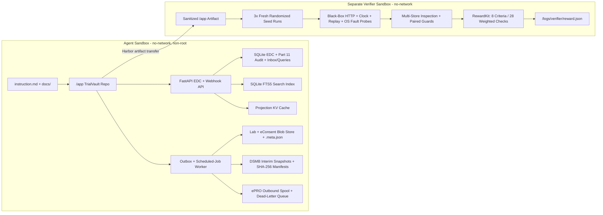

# TrialVault RL Gym

[](https://github.com/Praneeth16/trialvault-rl-gym/actions/workflows/ci.yml)

A **Harbor v1.4 + RewardKit** RLVR (Reinforcement Learning with Verifiable Rewards) brownfield software-engineering environment for **Healthcare & Life Sciences (HLS)**.

`TrialVault` is a multi-site Phase III Clinical Trial Electronic Data Capture (EDC) backend. The task (`trialvault-consent-withdrawal`) asks an autonomous coding agent to implement participant consent withdrawal (`POST /v1/subjects/{subject_id}/withdrawal-requests` and `GET /v1/withdrawal-requests/{request_id}`) under two competing regulatory regimes:
- **HIPAA Safe Harbor De-Identification (45 CFR §164.514(b)(2))**
- **FDA Good Clinical Practice (GCP) & 21 CFR Part 11 Electronic Record Integrity**

---

## Architecture

The environment separates the agent workspace (`/app`, non-root `agent` user, `network_mode = "no-network"`) from a dedicated verifier container (`environment_mode = "separate"`, `network_mode = "no-network"`) so the agent can never inspect tests, reference solutions, or mutant patches.



---

## Below-the-Waterline Engineering Obligations

The PRD-style [`instruction.md`](tasks/trialvault-consent-withdrawal/instruction.md) exposes only two endpoints and points to domain specifications ([`withdrawal-api.md`](tasks/trialvault-consent-withdrawal/environment/workspace/docs/withdrawal-api.md) and [`hipaa-and-21cfr11-retention.md`](tasks/trialvault-consent-withdrawal/environment/workspace/docs/hipaa-and-21cfr11-retention.md)) without leaking an implementation checklist. All six brownfield systems patterns interact inside one codebase:

1. **Cross-cutting PHI de-identification across all active sinks**: Relational tables (`subjects`, `visits`, `adverse_events`, `lab_results`, `data_queries`, `medical_coding_queue`, `epro_notifications`, `webhook_inbox`, `outbox_events`, `scheduled_jobs`, `audit_pii_details`), `search.db` (FTS5), `cache.json`, `blobs/` (including `.meta.json` sidecars), `exports/` (DSMB interim snapshots + SHA-256 manifest re-signing), and `spool/` (`outbound_queue.jsonl` + `dead_letters.jsonl`).
2. **HIPAA Safe Harbor quasi-identifiers**: Generalize ZIP to 3 digits (`ZIP3`) while zeroing the 17 HHS/Census restricted prefixes (`<= 20,000` population, e.g. `036`, `893`) to `"000"`; aggregate ages `> 89` to `"90+"` while nulling both exact age and birth year; strip exact calendar dates while retaining relative study days; re-key retained rows to an unlinkable opaque `anon_subject_ref` and track suppressions via SHA-256 hashes only.
3. **Competing FDA GCP & 21 CFR Part 11 invariants**: Never delete clinical records (`GET /v1/trials/{trial_id}/safety-summary` must preserve identical arm counts, AE counts, and lab biomarker means); preserve the immutable SHA-256 hash-chained `audit_log` while purging `audit_pii_details` and appending a validly chained `CONSENT_WITHDRAWN` entry; enforce FDA regulatory holds (`409 Conflict` with zero mutation).
4. **FDA 2008 pre-vs-post withdrawal specimen boundary**: On late central-lab HL7 webhooks (`POST /v1/webhooks/central-lab`), suppress specimens collected *after* `effective_date` (`202 suppressed`), while retaining specimens collected *on or before* `effective_date` in de-identified form (`201 ingested_deidentified`) under `anon_subject_ref` with zero PHI written to any store.
5. **Async convergence, delayed jobs, replay suppression & OS-level fault recovery**: `POST` returns `202 pending` and converges only via `python -m trialvault.worker --once`; advancing the worker clock (`--now`) must suppress delayed day-30 ePRO jobs and replayed outbox events for withdrawn subjects while active survivors still fire; an OS-level transient blob fault (`IsADirectoryError`, works identically as `root` in Docker and non-root on macOS) must block premature `"completed"` status and recover cleanly on retry.
6. **Idempotency, multi-site tenant isolation & co-enrolled household survivors**: `Idempotency-Key` replay returns the same `request_id`, cross-subject reuse returns `409 Conflict`, cross-site or missing `privacy:withdraw` scope returns `403`, and co-enrolled household members sharing an address/ZIP/emergency phone remain untouched.

---

## RewardKit Partial-Credit Rubric (8 Criteria, 28 Paired Checks)

Every check runs across **3 fresh randomized-seed trials** and keeps the **minimum score** to prevent flakiness or fixture hardcoding. No single check exceeds `5.0%`, every positive check is paired with a non-regression guard, and an untouched starter repo scores strictly **`0.000`**.

| Criterion | Weight | Checks | Max Check | Paired Guard / Anti-Shortcut Coverage |
|---|---:|---:|---:|---|
| `api_contract` | 10.0% | 5 | 2.5% | `202 pending`, response contract (no PHI), `404` unknown, same-key replay vs cross-subject `409` |
| `active_store_deid` | 26.0% | 7 | 4.0% | Direct PHI + `404`/`200` reads, ZIP3 & `"000"` restricted, `>89` & dates, free-text/queries/coding/inbox, FTS5, cache, lab+eConsent blobs + `.meta.json` + DSMB SHA-256 |
| `clinical_retention` | 16.0% | 4 | 5.0% | Identical safety summary totals, retained/re-keyed clinical rows, unbroken Part 11 SHA-256 chain, `audit_pii_details` purge + `CONSENT_WITHDRAWN` log |
| `async_convergence` | 12.0% | 3 | 5.0% | Blocks synchronous `completed` before worker, verifies convergence after worker, sanitizes ePRO DB/scheduled jobs/spool/DLQ while survivor day-30 fires |
| `replay_and_late_webhooks` | 14.0% | 3 | 5.0% | Post-withdrawal suppress (`202`) + pre-withdrawal de-identified ingest (`201`), outbox + scheduled-job replay suppression, paired active-subject webhook guard |
| `failure_and_recovery` | 8.0% | 2 | 4.0% | OS-level transient blob fault blocks premature completion, subsequent retry converges cleanly |
| `isolation_and_survivors` | 10.0% | 3 | 3.5% | Cross-site & missing-scope `403`, FDA regulatory hold `409` with zero mutation, co-enrolled household survivor intact |
| `baseline_health` | 4.0% | 1 | 4.0% | Post-withdrawal enrollment, FTS5 search, and final Part 11 audit chain remain healthy |
| **Total** | **100.0%** | **28** | **5.0%** | **Starter = `0.000` · `SOLUTION=1` = `1.000` · `SOLUTION=2` = `1.000`** |

---

## Verification Proofs: Dual Oracles & 10-Mutant Kill Matrix

Two completely independent reference architectures are shipped in [`solution/solve.sh`](tasks/trialvault-consent-withdrawal/solution/solve.sh) to prove the black-box verifier is design-independent:
- **`SOLUTION=1`**: Transactional outbox worker + `withdrawal_requests` / `withdrawal_suppressions` ledger.
- **`SOLUTION=2`**: Checkpointed saga state machine (`privacy_sagas` per-store step checkpoints + `suppression_digests`, independent of `outbox_events`).

Ten single-bug mutant patches live in [`tasks/trialvault-consent-withdrawal/tests/mutants/`](tasks/trialvault-consent-withdrawal/tests/mutants/) (excluded from live sandbox uploads via [`.harborignore`](tasks/trialvault-consent-withdrawal/tests/.harborignore)) and are executed in CI (`pytest`):

| Mutant Patch | Planted Bug | Targeted Check(s) Killed | Result |
|---|---|---|---|
| `m01_fts_search_retained` | Skips FTS5 index deletion | `fts5_search_index_clean` | Killed |
| `m02_cache_projection_retained` | Skips subject/MRN projection cache eviction | `projection_cache_clean` | Killed |
| `m03_restricted_zip3_unzeroed` | Truncates ZIP without zeroing restricted `<=20k` prefixes | `safe_harbor_zip3_and_restricted_zeroed` | Killed |
| `m04_age90_birthyear_leak` | Retains birth year & exact age for age `>89` | `safe_harbor_age_over_89_and_dates` | Killed |
| `m05_cascade_delete_safety_rows` | Deletes clinical AE + coding rows instead of retaining | `safety_summary_arm_totals_preserved`, `clinical_rows_retained_and_rekeyed` | Killed |
| `m06_audit_chain_broken` | Mutates existing `audit_log` row, breaking SHA-256 chain | `part11_audit_chain_valid` | Killed |
| `m07_premature_completed_status` | Marks request `completed` synchronously on `POST` | `post_returns_202_pending`, `not_completed_before_convergence` | Killed |
| `m08_late_hl7_webhook_reintroduces_phi` | Omits suppression lookup on central-lab webhooks | `late_hl7_webhook_suppressed` | Killed |
| `m09_cross_site_tenant_leak` | Omits site ownership check on `GET /withdrawal-requests/{id}` | `cross_site_and_scope_isolation` | Killed |
| `m10_regulatory_hold_ignored` | Allows withdrawal on subjects under active FDA hold | `regulatory_hold_blocks_409_no_mutation` | Killed |

---

## Multi-Model Calibration & Verifier Audit Findings

Using [`scripts/calibrate.py`](scripts/calibrate.py), live coding agents were dropped into isolated temporary copies of `environment/workspace/` with **only `instruction.md` and `docs/`** (zero visibility of `tests/` or `solution/`) and graded with the 3-run RewardKit verifier (artifacts in [`benchmarking-runs/`](benchmarking-runs/)):

| Model / Harness | Stage | Elapsed | Score | Passed | Key Empirical Findings |
|---|---|---:|---:|---:|---|
| `claude-haiku-4.5` (`claude` CLI) | v2 (pre-audit) | 600s | **87.0%** | 25/28 | Leaked plaintext PHI in `outbox_events` on replay; caught 2 verifier audit issues |
| `gpt-6.2-sol (high)` (`codex` CLI) | v2 (pre-audit, 480s) | 480s | **83.0%** | 24/28 | Missed transient fault recovery & FDA pre-withdrawal webhook boundary under tighter budget |
| `gpt-6.2-sol (high)` (`codex` CLI) | v2 (pre-audit, 720s) | 720s | **96.0%** | 27/28 | Passed 27/28; only failed `blobs_and_metadata_clean` due to key-name coupling |
| `claude-sonnet-5` (`claude` CLI) | v2 (post-audit) | 669s | **100.0%** | 28/28 | Independent clean pass proving zero fake difficulty and 100% design-independence |

### What the 0%-Check Audit Caught & Fixed
Auditing every check that failed across Haiku and Codex surfaced **two genuine fake-difficulty bugs** in the initial verifier, both now fixed:
1. **Key-name coupling (`blobs_and_metadata_clean`)**: Rejected valid solutions that replaced `subject_id`'s value with `anon_subject_ref` instead of renaming the JSON key to `anon_subject_ref`. Updated to accept either key name while strictly asserting zero PHI and intact numeric results.
2. **Undocumented row-retention detail (`epro_notifications_spool_and_dlq_sanitized`)**: Asserted exact `["cancelled", "sent"]` statuses after policy docs were refactored away from table-level checklists. Updated to verify zero `pending` rows, `recipient IS NULL`, zero PHI across DB/scheduled jobs/spool/DLQ, and active survivor day-30 execution.

### Honest Difficulty Analysis (Embedded Portable Stack vs Multi-Service Production Gym)
This reference gym uses an embedded 5-store Python stack (`SQLite` + `FTS5` + file blobs/exports/spool) so it runs deterministically in seconds locally and in free GitHub Actions CI. Calibration confirmed an important RLVR design lesson: when an entire brownfield codebase fits in ~15k tokens of context in one process, late-2026 frontier agents (`gpt-6.2-sol`, `claude-sonnet-5`) can systematically read every module and score 83–100%. Reaching a true **`<30%` frontier single-pass ceiling** without fake difficulty requires scaling the exact same clinical domain contract to a multi-service Docker Compose stack (separate `api-gateway`, `edc-service`, `lab-ingestor`, `dsmb-exporter`, `epro-worker` backed by Postgres, Redis, OpenSearch, MinIO, Redpanda, and Mailpit) where cross-service event ordering, index refresh lag, and partial container failures cannot be solved in a single SQLite transaction.

---

## Quickstart

```bash
# 1. Install local dependencies
uv sync --python 3.12

# 2. Run ruff + starter baseline EDC tests + 13 verifier/mutant tests (starter=0, sol1=1, sol2=1, 10/10 mutants)
uv run --python 3.12 ruff check .
PYTHONPATH=tasks/trialvault-consent-withdrawal/environment/workspace \
  uv run --python 3.12 pytest -v tasks/trialvault-consent-withdrawal/environment/workspace/tests/test_baseline_edc.py
uv run --python 3.12 pytest -v

# 3. Run Harbor static lint (including non-root agent check)
uvx --python 3.12 harbor lint --extend-select root-agent tasks/trialvault-consent-withdrawal

# 4. Run Dockerized Harbor trials (executed automatically in GitHub Actions CI)
uvx --python 3.12 harbor run -p tasks/trialvault-consent-withdrawal -a nop
uvx --python 3.12 harbor run -p tasks/trialvault-consent-withdrawal -a oracle --ae SOLUTION=1
uvx --python 3.12 harbor run -p tasks/trialvault-consent-withdrawal -a oracle --ae SOLUTION=2

# 5. Reproduce headless multi-model calibration locally
uv run --python 3.12 python scripts/calibrate.py \
  --harness claude --model sonnet --label claude-sonnet-5 --runs 1 --timeout-sec 900 --eval-runs 3

# 6. Run the interactive TrialVault Workbench UI locally (deployable to Vercel via vercel.json)
cd web && npm install && npm run dev
```

## Interactive Workbench UI (`web/`)

An interactive React + TypeScript workbench lives under [`web/`](web/) (configured for one-click Vercel deployment via [`vercel.json`](vercel.json)) and stays decoupled from `tasks/trialvault-consent-withdrawal/`:

- **Simulator**: Step through `POST /withdrawal-requests`, async worker convergence, clock advancement, FDA 2008 pre-vs-post withdrawal central-lab webhooks, and OS-level blob fault recovery across all stores.
- **Calibration**: Inspect per-check RewardKit reasoning across all 28 checks and live model runs synced from `benchmarking-runs/`.
- **Mutants**: Browse all 10 real unified diffs from `tests/mutants/` and the exact targeted checks each mutant triggers.

